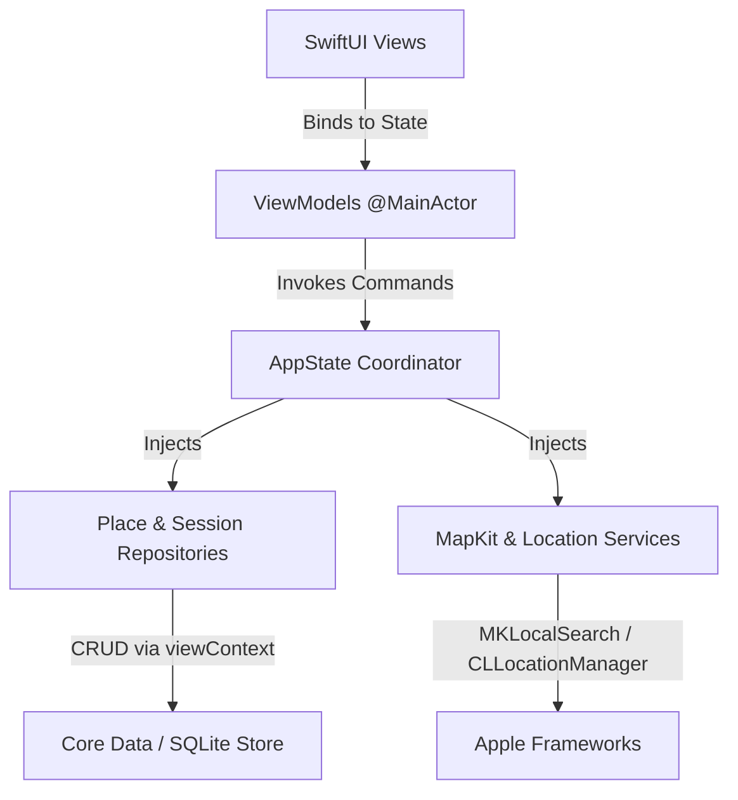

# StudySpot - Technical Architecture & Developer Guide

**Application:** StudySpot  
**Bundle ID:** `com.abhilashzz.studyspot`  
**Deployment Target:** iOS 17.0+  
**Language & UI:** Swift 5.9, SwiftUI, MapKit, Core Location, Core Data  
**Author:** Abhilash K A T W (IT22081698)  

---

## 1. High-Level Architectural Pattern: MVVM + Repository Pattern

StudySpot implements an enterprise-grade **Model-View-ViewModel (MVVM)** pattern combined with the **Repository Pattern** and protocol-oriented dependency injection.



### Architectural Principles
1. **Unidirectional Data Flow:** Views observe ViewModels; user actions trigger ViewModel methods; ViewModels interact with repositories/services and publish updated state.
2. **MainActor Thread Safety:** ViewModels and `AppState` are marked `@MainActor`, guaranteeing that published UI state modifications occur safely on the main run loop.
3. **Decoupled Value Types (`PlaceDTO`, `StudySessionDTO`):** SwiftUI views bind to immutable value structs rather than raw `NSManagedObject` instances. This eliminates concurrency crashes and managed object context lifecycle bugs.
4. **Protocol-Driven Services:** Search and location functionality sit behind abstract protocols (`PlaceSearchServiceProtocol`, `LocationServiceProtocol`), enabling seamless switching between live MapKit services and deterministic mock services for testing.

---

## 2. Core Data Persistence Architecture

### Model Schema (`StudySpot.xcdatamodeld`)
Core Data is configured with **Manual/None** code generation to avoid duplicate class definitions with the handwritten subclasses `Place.swift` and `StudySession.swift`.

#### Entity 1: `Place`
- `id`: `UUID` (non-optional primary key)
- `providerId`: `String` (optional Apple Maps provider/phone identifier)
- `name`: `String` (non-optional)
- `address`: `String` (non-optional)
- `latitude`: `Double` (non-optional, scalar)
- `longitude`: `Double` (non-optional, scalar)
- `category`: `String` (non-optional, default "Library")
- `isSaved`: `Boolean` (non-optional, scalar, default false)
- `personalNote`: `String` (optional)
- `wifiObservation`: `String` (non-optional, default "Unknown")
- `powerObservation`: `String` (non-optional, default "Unknown")
- `noiseObservation`: `String` (non-optional, default "Unknown")
- `createdAt`: `Date` (non-optional)
- `updatedAt`: `Date` (non-optional)
- **Relationship:** `sessions` -> To-Many to `StudySession`, Delete Rule: `Cascade`, Inverse: `place`.

#### Entity 2: `StudySession`
- `id`: `UUID` (non-optional primary key)
- `completedAt`: `Date` (non-optional)
- `durationMinutes`: `Integer 16` (non-optional, scalar, 1–240)
- `focusRating`: `Integer 16` (non-optional, scalar, 1–5)
- `note`: `String` (optional)
- **Relationship:** `place` -> To-One to `Place` (required), Delete Rule: `Nullify`, Inverse: `sessions`.

---

## 3. Deduplication Algorithm

To prevent duplicate place records whenever a student repeatedly bookmarks a spot from different search queries, `PlaceRepository.findOrCreateEntity(for:)` applies a two-tier deduplication check:

1. **Provider Identifier Match:**
   ```swift
   if let providerId = dto.providerId, !providerId.isEmpty {
       request.predicate = NSPredicate(format: "providerId ==[c] %@", providerId)
       if let existing = try context.fetch(request).first { ... }
   }
   ```
2. **Normalized Name & Spatial Proximity Match:**
   If a provider ID is missing or synthetic, a spatial query searches within `±0.001` degrees (~100 meters) for matching case-insensitive venue names:
   ```swift
   request.predicate = NSPredicate(
       format: "name ==[c] %@ AND latitude BETWEEN {%lf, %lf} AND longitude BETWEEN {%lf, %lf}",
       dto.name,
       dto.latitude - 0.001, dto.latitude + 0.001,
       dto.longitude - 0.001, dto.longitude + 0.001
   )
   ```
3. If an existing entity is found, its address, category, and timestamps are updated in place, preventing redundant entries.

---

## 4. Safe Unfavourite Semantics vs. Permanent Deletion

A critical requirement of Part A is maintaining session history when an unfavourite action occurs:

- **Unfavourite (`isSaved = false`):**
  When a user taps the bookmark icon or swipes "Unsave", `PlaceRepository.unsavePlace(id:)` simply flips `isSaved = false`. The `Place` record and its linked `StudySession` children remain intact in the database.
- **Permanent Deletion:**
  Triggered only through an explicit ellipsis menu option. The view model queries `linkedSessionCount` and presents an iOS confirmation dialog clearly stating: *"This will permanently remove X and its N associated study sessions from your local database."* Upon confirmation, the parent `Place` is deleted, and Core Data cascades deletion to its child sessions.

---

## 5. MapKit & Core Location Integration

### Local Search (`MKLocalSearch`)
Implemented in `MapKitSearchService.swift`:
- Uses `MKLocalSearch.Request` with `resultTypes = .pointOfInterest`.
- Coordinates queries based on the active map camera region (`MKCoordinateRegion`).
- **Cancellation & Debounce:** Any superseded in-flight task is actively cancelled via `activeSearch?.cancel()` to prevent stale responses from overwriting newer user queries.
- **Error Handling:** Catches `NSURLErrorCancelled`, `NSURLErrorNotConnectedToInternet`, and MapKit rate-limit exceptions, transforming them into user-facing `SearchServiceError` enums.

### Core Location & Permissions
Implemented in `CoreLocationService.swift`:
- Requests authorization **only on user demand** when the user taps "Near Me" via `locationManager.requestWhenInUseAuthorization()`.
- Uses `kCLLocationAccuracyHundredMeters` to balance quick acquisition with battery conservation.
- Safely handles `.denied` and `.restricted` states: rather than crashing or blocking the app, a gentle banner informs the user that manual search is available.

### Apple Maps Directions Handoff
Launches native Apple Maps walking directions using public APIs:
```swift
let placemark = MKPlacemark(coordinate: place.coordinate)
let mapItem = MKMapItem(placemark: placemark)
mapItem.name = place.name
mapItem.openInMaps(launchOptions: [MKLaunchOptionsDirectionsModeKey: MKLaunchOptionsDirectionsModeWalking])
```

---

## 6. Multi-Store Architecture: Production vs. Demo Mode

To allow testing and evaluation without corrupting student records, StudySpot implements an isolated multi-store architecture:
- **Production Store:** `StudySpot.sqlite` located in Application Support.
- **Demo Store:** `StudySpot_Demo.sqlite` initialized dynamically when Demo Mode is toggled in Settings.
- **In-Memory Store:** `/dev/null` initialized for SwiftUI Previews and automated unit tests.

---

## 7. Automated Test Architecture

The project contains two testing targets configured in `StudySpot.xcodeproj`:

1. **`StudySpotTests` (XCTest Unit Tests):**
   - `PlaceValidationTests.swift`: Range checks on duration, ratings, coordinates, and notes.
   - `PlaceDeduplicationTests.swift`: Verifies provider and coordinate deduplication.
   - `StudySessionCRUDTests.swift`: Comprehensive Create, Read, Update, Delete cycles.
   - `RelationshipCascadeTests.swift`: Proves safe unfavourite preserves history; verifies permanent delete cascades.
   - `ProgressAggregationTests.swift`: Validates date range filtering and chart point generation.
   - `SearchCancellationTests.swift`: Tests async cancellation and simulated network errors.
   - `StoreReopeningTests.swift`: Persists to a temporary SQLite store, tears down container, and verifies survival on reload.

2. **`StudySpotUITests` (XCTest UI Tests):**
   - `StudySpotFlowUITests.swift`: End-to-end automation covering Explore -> Details -> Save -> Saved Places -> Log Session -> My Progress.
